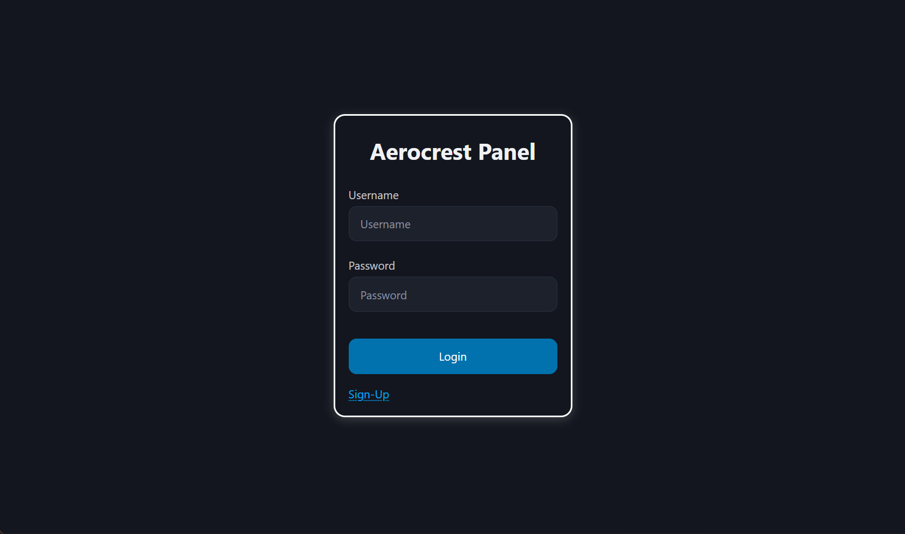
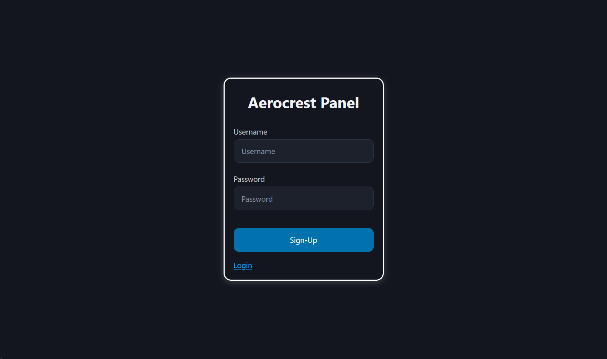

<h1 align="center">Aerocrest</h1>
A Fast Hosting Management Panel Made with GO, chi and go's HTML template package

### What is aerocrest ?

Aerocrest similarly to pterodactyl or pelican is a hosting management panel. Connect your nodes using slipstream and on the panel, users can create their own game/web servers on said nodes.

> [!NOTE]
> 
> Aerocrest currently only supports Debian based Linux distros
> 
> Additionally, at the current stage aerocrest is not production ready but still a work in progress

### Tech Stack:

- Go 1.27.1
- ini v1
- Argon 2ID
- PGX
- Go Chi V5
- google/uuid
- HTML
- Pico CSS
- PostgreSQL
- fsouza/go-dockerclient
- chyeh/pubip
- gorilla/websocket
- log/slog

### How to run:
    
##### On the nodes:

   1. Git clone the repository
   `git clone https://github.com/SlowOnARocketTM/Aerocrest.git`
   2. cd into the slipstream daemon folder and run
   `sudo chmod +x ./setup.sh && sudo ./setup.sh`
    then make sure go 1.27.1 is installed
   `go run ./cmd`
   3. Open the daemon's port on the firewall
   `sudo apt install ufw`
   `sudo ufw default deny incoming && sudo ufw default allow outgoing`
   `sudo ufw allow 22/tcp && sudo ufw allow <daemon_port>/tcp`
   `sudo ufw enable`

##### On the panel:

   1. Git clone the repository
   `git clone https://github.com/SlowOnARocketTM/Aerocrest.git`
   2. cd into the panel folder and run
   `sudo chmod +x ./setup.sh && sudo ./setup.sh`
    then make sure go 1.27.1 is installed
    `go run ./cmd`
   3. Open the panel's port on the firewall
      `sudo apt install ufw`
      `sudo ufw default deny incoming && sudo ufw default allow outgoing`
      `sudo ufw allow 22/tcp && sudo ufw allow <panel_port>/tcp`
      `sudo ufw enable`

### Screenshots
| Login | Sign-Up|
| --- | --- |
|  |  |
